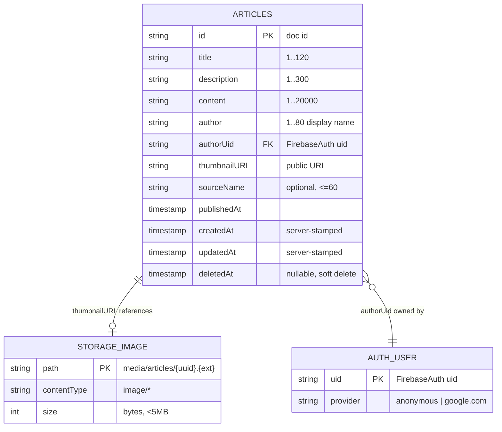
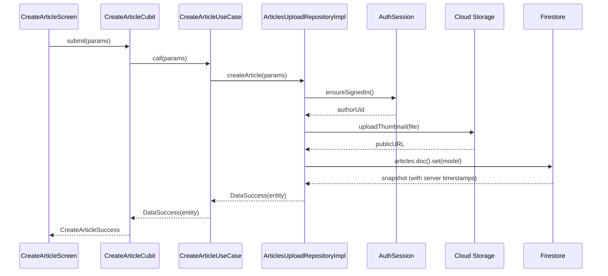

# Database Schema — Applicant Showcase App

Diseño del esquema NoSQL en Firebase Firestore para la funcionalidad de **upload de artículos** por parte del periodista (usuario autenticado).

---

## Filosofía de diseño

El schema se modela bajo tres principios:

1. **Paridad con la API existente (NewsAPI)** — los campos reflejan los que ya usa `ArticleEntity` en `frontend/lib/features/daily_news/domain/entities/article.dart` para facilitar reutilización de widgets y una eventual fusión de ambas fuentes en la misma lista.
2. **Enforcement real en reglas** — cada campo tiene un tipo, un tamaño máximo y una regla de validación que se aplica en `firestore.rules`. El schema no es solo documentación, es contrato verificable en el servidor.
3. **Owner-scoped por `authorUid`** — cada documento lleva el UID del creador para que las reglas puedan restringir `update/delete` al dueño sin necesidad de subcolecciones.

---

## Diagrama ER (Mermaid)



### Flujo de creación



---

## Colección raíz: `articles/{articleId}`

Una sola colección plana. No se usan subcolecciones porque:

- El volumen esperado (decenas a miles de artículos totales) no justifica sharding.
- Todas las queries relevantes (lista general, artículos por autor, detalle) se resuelven con índices compuestos sin necesidad de joins.
- Las subcolecciones complicarían las reglas de seguridad sin aportar beneficio.

### Estructura del documento

| Campo           | Tipo        | Requerido | Validación                                                          | Descripción |
|-----------------|-------------|-----------|---------------------------------------------------------------------|-------------|
| `id`            | string      | Sí        | Igual al document ID (se denormaliza para facilitar serialización)  | Identificador único del artículo |
| `title`         | string      | Sí        | `1 <= length <= 120`                                                 | Titular del artículo |
| `description`   | string      | Sí        | `1 <= length <= 300`                                                 | Resumen/lead corto |
| `content`       | string      | Sí        | `1 <= length <= 20000`                                               | Cuerpo completo en texto plano |
| `author`        | string      | Sí        | `1 <= length <= 80`                                                  | Nombre visible del periodista (display name) |
| `authorUid`     | string      | Sí        | `== request.auth.uid` en creación                                    | UID de Firebase Auth del creador — usado por reglas de `update/delete` |
| `thumbnailURL`  | string      | Sí        | URL de descarga devuelta por Cloud Storage, debe apuntar a `media/articles/...` | Imagen destacada |
| `sourceName`    | string      | No        | `length <= 60` si está presente                                      | Nombre del medio, opcional. Facilita compatibilidad con la lista de NewsAPI |
| `publishedAt`   | timestamp   | Sí        | Debe ser `<= request.time`                                           | Fecha de publicación (usuario puede elegirla o usar now) |
| `createdAt`     | timestamp   | Sí        | `== request.time` en creación                                        | Timestamp de creación (auditoría) |
| `updatedAt`     | timestamp   | Sí        | `== request.time` en creación y update                               | Timestamp de última edición |

**Campos prohibidos en write:** cualquier campo fuera de esta lista → rechazado por regla `hasOnly()`.

---

## Decisiones de diseño (rationale)

### `authorUid` separado de `author`
- `author` es un string mutable visible (ej: "Luis A. De La Torre").
- `authorUid` es inmutable, viene de Firebase Auth y sirve para las reglas.
- Separarlos permite cambiar el nombre visible sin perder ownership.

### `thumbnailURL` como URL completa, no como ruta
- El frontend recibe directamente una URL que puede pasar a `Image.network()` / `CachedNetworkImage`.
- Evita lógica cliente-side para construir URLs firmadas.
- Trade-off: si la imagen se borra en Storage, el doc queda con URL rota. Se mitiga con un trigger `onDelete` (ver `README_best.md` C.5).

### `id` denormalizado dentro del documento
- Redundancia intencional: el mismo valor vive en el path del documento y dentro del payload.
- Facilita que el `ArticleModel` del frontend pueda serializar/deserializar sin leer el snapshot ID por separado.
- Pequeño costo de storage, gran simplicidad de código.

### Tres timestamps (`publishedAt` / `createdAt` / `updatedAt`)
- `publishedAt` es **intención editorial** (puede ser antes de ahora, por ejemplo si el periodista importa contenido antiguo).
- `createdAt` es **auditoría del sistema** (cuándo se insertó en la BD).
- `updatedAt` facilita cache invalidation y ordenamiento por actividad reciente.

### Sin `tags` / `category` / `likes` en el MVP
- El reto pide CRUD básico. Añadir taxonomía ahora dispara complejidad (índices adicionales, validación de listas, etc.).
- Se listan en `README_best.md` como sobreentrega futura.

---

## Cloud Storage — `media/articles/{file}`

Los thumbnails se suben al bucket de Cloud Storage bajo el prefijo `media/articles/`. El path final contiene un UUID v4 para evitar colisiones y no filtrar metadata:

```
media/articles/{uuid-v4}.{ext}
```

Ejemplo: `media/articles/0f8c4d2e-5b7a-4f1c-a3e9-8d6f2b9c1a5e.jpg`

**Restricciones (`storage.rules`):**
- `contentType` debe empezar con `image/` (jpeg, png, webp).
- Tamaño máximo: **5 MB**.
- Escritura: solo usuarios autenticados.
- Lectura: pública (las imágenes se embeben en la app).

**Nota sobre aislamiento por usuario:** en este MVP, cualquier usuario autenticado puede escribir en `media/articles/`. Una mejora natural (ver `README_best.md` C.4) sería cambiar el path a `media/articles/{authorUid}/{uuid}.{ext}` para aislar archivos por dueño y facilitar limpieza en bulk cuando se elimina una cuenta.

---

## Queries soportadas

| Query | Cómo se resuelve | Índice necesario |
|---|---|---|
| Lista de todos los artículos, más recientes primero | `articles.orderBy('publishedAt', desc).limit(20)` | Automático (single-field) |
| Artículos de un autor específico | `articles.where('authorUid', '==', uid).orderBy('publishedAt', desc)` | **Compuesto**: `(authorUid ASC, publishedAt DESC)` — declarar en `firestore.indexes.json` |
| Detalle por ID | `articles.doc(id).get()` | N/A |
| Paginación | `.startAfterDocument(lastDoc).limit(20)` | Mismo índice base |

---

## Reglas de seguridad — resumen operacional

Ver `firestore.rules` para la implementación completa. En resumen:

- **`read`**: público (cualquiera puede leer artículos publicados, incluso sin login).
- **`create`**: usuario autenticado + payload cumple el schema + `authorUid == request.auth.uid` + `createdAt == updatedAt == request.time`.
- **`update`**: solo el dueño (`authorUid == request.auth.uid`), no puede cambiar `authorUid` ni `createdAt`, debe actualizar `updatedAt == request.time`.
- **`delete`**: solo el dueño.

---

## Estimación de costos (plan Spark → Blaze free tier)

Supuestos para un MVP del reto técnico (1 usuario, uso esporádico):

| Operación | Cantidad/día | Límite free tier | Margen |
|---|---|---|---|
| Reads | ~100 | 50,000 | 99.8% libre |
| Writes | ~20 | 20,000 | 99.9% libre |
| Storage | ~10 MB total | 5 GB | 99.8% libre |
| Storage download | ~50 MB/día | 1 GB/día | 95% libre |

**Costo esperado: $0.00 USD/mes.** Budget alert en Google Cloud configurado a $1 como red de seguridad.

Para una estimación de producción (1k–10k DAU) ver `README_best.md` item C.12.

---

## Evolución futura (no en este MVP)

- Campo `schemaVersion: number` para migraciones seguras (C.1).
- Subcolección `articles/{id}/comments` cuando se añada feedback de lectores.
- Denormalización de `articleCount` en `users/{uid}` vía Cloud Function trigger.
- Soft delete con campo `deletedAt` (C.6).
