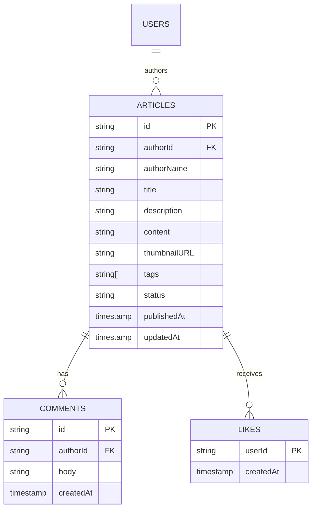

# Data schema — `user_articles` feature

> Contract between the Flutter app and Firebase that the rules and data
> layer rely on. Freezes **before** we wire the `user_articles` data
> sources in F8 so the model/DTO layer can be generated against it.

---

## Firestore — collection `articles/{articleId}`

Every article written by a signed-in user lives in the top-level
`articles` collection. The `authorId` field is the single source of truth
for ownership and is what the security rules pivot on.

| Field           | Type          | Required | Description                                                                                       |
|-----------------|---------------|----------|---------------------------------------------------------------------------------------------------|
| `id`            | `string`      | yes      | Mirror of `{articleId}` — kept in the document so lists can render without the snapshot id.       |
| `authorId`      | `string`      | yes      | `request.auth.uid` of the creator. Never rewritten after creation.                                |
| `authorName`    | `string`      | yes      | Denormalised display name (avoids an extra read on the feed). 1 – 60 chars.                       |
| `title`         | `string`      | yes      | 5 – 120 chars. Validated client-side (`canPublish`) and by the rules.                             |
| `description`   | `string`      | yes      | 0 – 280 chars. Used for list previews.                                                            |
| `content`       | `string`      | yes      | ≥ 50 chars, ≤ 20 000 chars. Markdown allowed.                                                     |
| `thumbnailURL`  | `string`      | yes      | HTTPS URL pointing at `media/articles/{authorId}/{articleId}/thumbnail.*` (see Storage below).    |
| `tags`          | `list<string>`| no       | 0 – 5 entries, each 1 – 24 chars, lower-case.                                                      |
| `status`        | `string`      | yes      | Enum `draft` \| `published`. Only `published` documents render in the public feed.                 |
| `publishedAt`   | `timestamp`   | yes      | Written once with `serverTimestamp()` on the create. Immutable afterwards.                        |
| `updatedAt`     | `timestamp`   | yes      | Bumped with `serverTimestamp()` on every write.                                                   |

### Example document

```jsonc
// articles/2zR3... (doc id = articleId)
{
  "id":           "2zR3pKq4bT7",
  "authorId":     "J1oKhNnq9HR0vUaoN5TxxH4m",
  "authorName":   "Abraham Jiménez",
  "title":        "Clean architecture in Flutter",
  "description":  "Notes from a 72h coding challenge.",
  "content":      "## Why the separation matters ...",
  "thumbnailURL": "https://firebasestorage.googleapis.com/v0/b/symmetry.appspot.com/o/media%2Farticles%2FJ1oKhNnq9HR0vUaoN5TxxH4m%2F2zR3pKq4bT7%2Fthumbnail.jpg?alt=media",
  "tags":         ["flutter", "clean-architecture"],
  "status":       "published",
  "publishedAt":  { "__type__": "timestamp", "seconds": 1714003200 },
  "updatedAt":    { "__type__": "timestamp", "seconds": 1714003200 }
}
```

### Indexes

Only the default single-field indexes are required for the screens this
challenge ships. The two queries we run are:

- `articles.where('authorId', '==', uid).orderBy('updatedAt', desc)` —
  served by the auto-generated composite index created on first run.
- `articles.where('status', '==', 'published').orderBy('publishedAt', desc)`
  — served by the auto-generated composite index created on first run.

Any additional composite index gets registered in
[`firestore.indexes.json`](../firestore.indexes.json).

### Future subcollections (not implemented)

Documented so the `isValidArticle()` rule keeps room for them:

- `articles/{articleId}/comments/{commentId}` — `{ authorId, body, createdAt }`.
- `articles/{articleId}/likes/{userId}` — `{ createdAt }` (presence ⇒ liked).

Both would be guarded by their own `match` blocks in `firestore.rules`.

---

## Cloud Storage — path `media/articles/{authorId}/{articleId}/{file}`

Thumbnails and inline images referenced by a document live under the
article's folder so access-control collapses to a single path prefix.

| Constraint        | Value                                    |
|-------------------|------------------------------------------|
| Allowed writers   | `request.auth.uid == authorId`           |
| Max size          | `5 * 1024 * 1024` bytes (5 MiB)          |
| Allowed content   | `image/*` (png, jpg, webp, heic)         |
| Read access       | Public (`allow read: if true`)           |

The filename convention we recommend from the client is
`thumbnail.<ext>` for the main image and `inline-{n}.<ext>` for any
additional attachment. The rules don't pin the filename — only the
folder depth and the content-type/size checks above.

---

## Schema diagram (mermaid)


