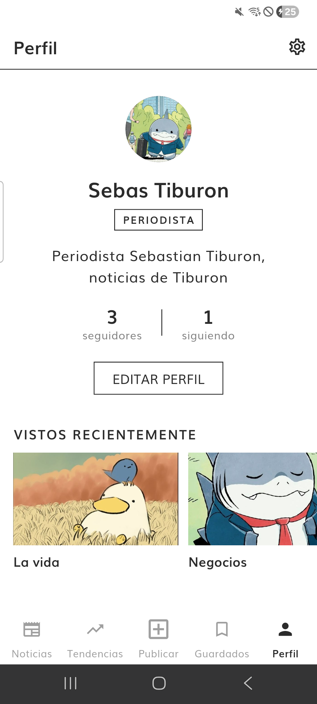

# Report: Symmetry News

Symmetry News is a news app where **journalists publish articles** and **readers read, save and comment on them, and follow their authors**. It is built with **Flutter**, **BLoC (cubits)** and **Firebase** (Authentication, Cloud Firestore and Cloud Storage), following the Clean Architecture described in [APP_ARCHITECTURE.md](./APP_ARCHITECTURE.md).

## 1. Introduction
I read the README and thought it was a good technical test to apply what I know and to learn new things I had not used before. My experience with Flutter comes from building a habit-tracking app called HabitDuck, where I learned how to install Flutter, how screens work and how to run the app properly on my phone. I also used Firebase in HabitDuck, to sign in with Google and to move the user's data from the phone itself to the cloud with Firestore.

After reading the README and all the guide files, I decided to build an app for journalists and readers, each with their own role and limits, because it let me apply what I had learned about handling roles in previous projects. Regular users cannot publish, because they do not have the journalist role, and they cannot give themselves that role either: an administrator assigns it with a script that changes the role in Firebase. I also followed the idea of a social network: you can comment, save articles and follow both journalists and regular users, because you may like what someone contributes in a comment on an article. I included these tabs:

- News
- Trends
- Publish (only visible to users with the journalist role)
- Saved
- Profile

In News we can read the articles of the people we follow (*Following*) or discover those of authors we do not follow yet (*For you*). In Profile we can also edit our profile: photo, name and description.

## 2. Learning Journey
I already knew Flutter and Firebase, but I did not know the BLoC concept or how to apply a good Clean Architecture, splitting the project into 3 layers: data, domain and presentation. The domain layer opens up many possibilities, because it holds all the business logic, and that logic does not depend on the backend we use. So if we wanted to replace the Firebase backend with a local one, or the other way around, we would only change the data layer, without touching the presentation layer (what the user sees).

Technologies used in the project:

- **Flutter and Dart 3:** sealed classes, records, pattern matching with `switch` expressions and wildcard variables.
- **BLoC (cubits)** for UI state, tested with `bloc_test` and `mocktail`.
- **Firebase Authentication** (email and password) with **custom claims** for the roles.
- **Cloud Firestore** and **Cloud Storage**, protected by **security rules** tested with the Firebase emulators.
- **flutter_quill** for the rich text editor, stored as Quill Delta JSON.
- **rxdart** (`switchMap`) to combine the Auth session with the Firestore profile.
- **shared_preferences** to remember the appearance (light or dark) on the device.

## 3. Challenges Faced

| Challenge | How it was solved | Lesson |
|---|---|---|
| The starter project did not build on Android: outdated Gradle, `ionicons` extending the now `final` class `IconData`, and packages using the removed v1 embedding. | Upgraded Gradle, the Android Gradle Plugin and Kotlin, replaced `ionicons` with Material icons and upgraded the incompatible packages. | Fix the foundation first: everything else depends on it. |
| `firebase_auth` 7 is compiled with Kotlin 2.4, which the old Kotlin plugin could not read. | Upgraded Kotlin to 2.4.0. | Read the actual error (metadata version) instead of guessing. |
| The Storage rules allowed overwriting other journalists' images, because `create` also applies to existing paths. | Added `resource == null` and a test for it. | Security rules need tests for what must be **denied**, not only for what is allowed. |
| A Storage test passed for the wrong reason: a file left by another test changed the outcome. | Every test uses a unique file name (`randomUUID`). | Tests must be independent from each other. |
| The Firebase CLI replaces `node` inside `emulators:exec`, so the tests could not find the test runner. | The test script uses `$npm_node_execpath`. | — |
| Selected topic chips were unreadable: the label and the background had the same color. Flutter ignores `secondaryLabelStyle` in Material 3. | The label color is a `WidgetStateColor` that switches on the selected state, with a widget test for both themes. | Check the framework source when a style does not apply. |
| Signing up failed with a generic connection error. | The real error was `auth/configuration-not-found`: Firebase Authentication had not been enabled in the console. | Unexpected errors should be logged in debug builds to be found quickly. |
| Requesting two counters in parallel with `(a, b).wait` wrapped a network failure in a `ParallelWaitError` (an `Error`, not an `Exception`) that the app did not catch. A test found it before it reached the phone. | Switched to `Future.wait`, which rethrows the original exception. | Tests for the failure paths find bugs the happy path never shows. |
| The packages that fake Firebase in unit tests (`fake_cloud_firestore`, `firebase_auth_mocks`, `firebase_storage_mocks`) are not compatible with the current Firebase and `equatable` versions. | Data sources are kept thin: they only translate between Firebase and models. Models and repositories have unit tests, and the security rules are tested against the emulators. | — |

## 4. Reflection and Future Directions
I learned that we should always do our best to keep the code readable and scalable, and to always use version control with git, making small commits and reviewing them before committing.

Future improvements:

- **Pagination** of the feed (it shows the 50 most recent articles today) and of the comments (the 100 most recent).
- **Cloud Functions** to delete orphaned data (comments and images of deleted articles, follows of deleted accounts) and to send **push notifications** (only the preference is stored today).
- Update the author name on articles and comments when a user renames themselves (today they keep the name they were published with).
- Unit tests for the data sources once the fake packages support the current versions, or integration tests against the emulators.

## 5. Proof of the project

- **Promo video (45 s, vertical):** [docs/media/symmetry-news-promo.mp4](./media/symmetry-news-promo.mp4). It shows the real app in the light theme with a journalist's profile: writing, publishing, appearing in the feed and in trends, comments, followers and profile.
- **App walkthrough (63 s, recorded on the phone):** [docs/media/app-walkthrough.mp4](./media/app-walkthrough.mp4). The app working on a real device: comments, trends, profile editing, the dark theme, the editor with its validation messages and saved articles.
- **News tab** (*For you* section) and **my journalist profile** (photo, role, bio and followers), real screenshots from the phone in the light theme:

  
  &nbsp;&nbsp;
  

## 6. Overdelivery

### New features implemented

- **Reader and journalist roles.** Only journalists can publish. The role is a custom claim set with the Admin SDK (`npm run set-role`), so nobody can grant it to themselves. The app shows a role change at once, because it listens to the user's profile.
- **Rich text editor:** headings, bold, italic, lists, quotes, highlight and images inside the article.
- **Edit and delete** own articles.
- **Saved articles**, with optimistic updates that are reverted if saving fails.
- **Comments:** any user can comment and delete their own comments.
- **Following users** and **public profiles** with followers, following and articles.
- **News in two sections:** *For you* (authors you do not follow) and *Following*.
- **Trends:** the topics with the most articles of the last 7 days.
- **Reading history:** the last 10 articles viewed, on the profile.
- **Settings:** light or dark appearance (remembered on the device), notifications, terms and conditions, legal notice and **account deletion** (confirmed with the password).
- **Profile editing:** photo, first name, last name and bio.
- **Own black and white style**, with light and dark themes.
- **Security rules for the whole schema**, covered by 125 tests against the emulators.
- **Demo data:** `npm run seed` creates 4 journalists, 10 articles, 3 readers, comments and follows, and `npm run seed -- --remove` deletes them.

### Prototypes created

- **Database schema:** [backend/docs/DB_SCHEMA.md](../backend/docs/DB_SCHEMA.md), with the design decisions and known limitations.
- **Promo video** made with HyperFrames (HTML to video) from real screenshots of the phone.

### How can this be improved
Ideas: article search, real push notifications, offline mode and statistics for journalists.

## 7. Extra Sections

### Architecture
Each feature (`auth`, `articles`, `comments`, `profiles`, `settings`) has its own data, domain and presentation layers. What several features share lives in `shared/users` (the user) and in `core` (`DataState`, common exceptions, image format).

- The **domain** is pure Dart. Use cases validate the input before calling the repositories, so invalid data never reaches the server. The business rules live there: at most 3 topics, the last 10 entries of the history, the trends ranking.
- The **data sources** are the only classes that import Firebase or `shared_preferences`, and they translate Firebase error codes into domain exceptions.
- **Cubits** are the only presentation classes that call use cases.

Decisions that extend or deviate from the architecture document:

| Decision | Reason |
|---|---|
| `exceptions/` folder in the domain | Business errors such as `ArticleValidationException` belong to the domain. |
| `image_picker` is used in the presentation layer | Picking an image is a user interaction, like typing in a text field. It returns bytes that the domain validates. |
| No model for the `Appearance` enum | Models extend entities, and an enum cannot be extended. It is stored by its id. |
| `runAsDataState` helper in `core/resources` | Every repository wraps exceptions in `DataState` in the same way, without repeating the `try/catch`. |
| The user lives in `shared/users` | Both `auth` and `profiles` use it. One feature's domain importing another's would break the layer rule. |

### Metrics

- Flutter tests: **239**, all passing (`flutter test`).
- Security rules tests: **125**, all passing (`npm test` in `backend`).
- `flutter analyze`: no issues.

### Use of AI
The project was developed with Claude Code as a programming assistant. I defined the product (roles, screens, style and staged delivery), made the decisions that were presented as options, reviewed every change and tested the app on a real phone. Every commit was explicitly approved by me.
